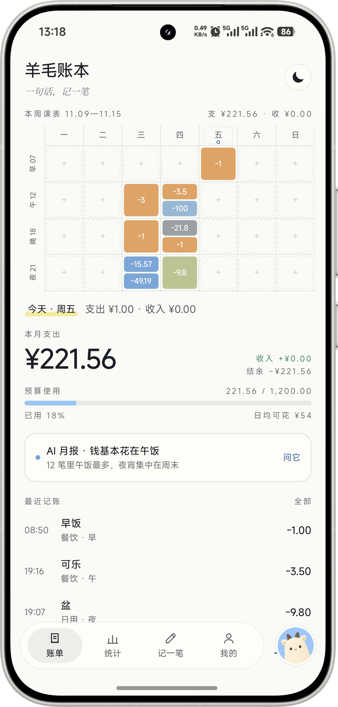
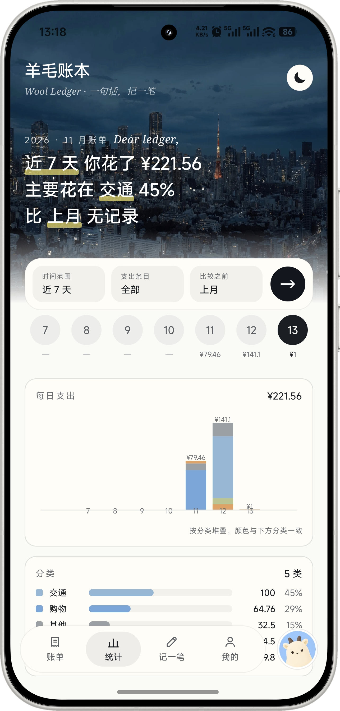

<div align="center">
  
  <h1>羊毛账本 · Wool Ledger</h1>
  <p><strong>一句话，记一笔。</strong></p>
  <p>把日常收支排成一张课表，让每一笔开销都有迹可循。</p>
  <p>
    
    
    <a href="LICENSE"></a>
  </p>
  <p><a href="#真机预览">真机预览</a> · <a href="#构建与运行">构建与运行</a> · <a href="#ai-与离线使用">AI 与离线使用</a> · <a href="https://github.com/shanchuann/WoolLedger/issues">反馈问题</a></p>
</div>

羊毛账本是一款原生 Android 个人记账应用。手动录入、用一句话描述消费，或通过离线语音输入，再用消费课表、分类统计和小票式报告回看消费习惯。账目保存在本机，无需注册账号，也无需部署后端。

## 真机预览

以下五张图片来自 Android 真机，展示账单、统计、录入、设置与助手界面。截图中的金额仅用于功能展示。

<table>
  <tr>
    <td align="center" width="33%"><br><strong>账单 · 一周收支一眼看清</strong></td>
    <td align="center" width="33%"><br><strong>统计 · 看见钱花在哪里</strong></td>
    <td align="center" width="33%"><br><strong>记一笔 · 手动、文字、语音</strong></td>
  </tr>
</table>
<table>
  <tr>
    <td align="center" width="50%"><br><strong>我的 · 按自己的节奏记账</strong></td>
    <td align="center" width="50%"><br><strong>蓝羊羊 · 和账本聊一聊</strong></td>
  </tr>
</table>

## 能做什么

- **一句话记账**：从「午饭食堂 15，昨天打车 23」提取金额、分类和日期，支持按标点拆分多笔记录。
- **消费课表**：以一周七天、早午晚夜四个时段展示账目；点击查看明细，长按拖拽调整日期与时段。
- **收支管理**：分类、搜索、编辑、删除与撤销，保留手动、AI、语音等录入来源。
- **预算与统计**：月度预算、自定义账期、每日支出、分类与时段分析、对比及明细下钻。
- **账本助手**：蓝羊羊问答、消费观察与小票式报告，可接入用户自行选择的兼容接口。
- **日常工具**：CSV 导入导出、每日提醒、浅色与深色主题。

## 构建与运行

| 项目 | 要求 |
| --- | --- |
| 运行设备 | Android 7.0（API 24）及以上 |
| 原生架构 | `arm64-v8a`、`x86_64` |
| JDK | 17 或兼容版本 |
| Android SDK | Platform 35 |
| 构建工具 | Gradle 8.13 Wrapper、Android Gradle Plugin 8.13.2 |

```sh
git clone https://github.com/shanchuann/WoolLedger.git
cd WoolLedger/android/WoolLedger
./gradlew assembleDebug
```

Windows 使用 `gradlew.bat assembleDebug`。也可以用 Android Studio 打开 `android/WoolLedger`，安装所需 SDK、完成同步后点击 Run。命令行构建需设置 `ANDROID_HOME`，或在工程目录的 `local.properties` 中配置 `sdk.dir`。

产物位于 `android/WoolLedger/app/build/outputs/apk/debug/wool_ledger.apk`。连接设备后可运行 `./gradlew installDebug`。

首次启动会创建演示账目。如需从空账本开始，可在「我的 → 数据 → 清空所有账目」中清除；清空前请确认是否需要导出。

### 离线语音模型

工程包含 sherpa-onnx Android AAR；中文 Paraformer 模型单独下载，不进入 Git。构建任务会尝试从缓存或网络准备约 78 MB 的模型包，首次构建需要联网并可能耗时较长。下载地址与任务位于 `app/build.gradle`，其中包含 GitHub 及第三方镜像回退地址。

模型下载失败时仍可构建，应用内可继续安装模型。模型就绪后，语音识别在设备上运行。跳过模型准备可使用：

```sh
./gradlew assembleDebug -x prepareVoiceModelAsset
```

若本地 `app/src/main/assets/voice-model/` 已有模型，该命令仍会将它打入 APK。

### Release 签名

版本号由 `android/WoolLedger/version.properties` 管理。正式签名配置保存在本地 `keystore.properties`，格式见 [配置模板](android/WoolLedger/keystore.properties.example)。密钥库与密码不提交到仓库。未提供签名配置时，`assembleRelease` 生成未签名产物；本地安装请使用 debug 构建。

## AI 与离线使用

在「我的」中设置 API Base URL、API Key 和模型名，保存后可测试连通性。接口需兼容 `POST {Base URL}/chat/completions`，Base URL 应包含服务所需的版本路径（例如 `/v1`）。默认配置为 DeepSeek 兼容接口，仓库不提供 API Key。

未填写 Key 时，自然语言记账使用本地规则，问答与报告使用本地文案；在线请求失败也会回退。本地规则对复杂表述的理解有限，请核对金额、日期与分类。远端模型调用由所选服务商按其规则计费。

## 数据与隐私

- 账目保存在本机 SQLite，预算、偏好与 API 配置保存在应用私有 SharedPreferences；当前 API Key 未做额外加密。
- 启用在线 AI 后，待解析文字、提问或账本摘要会发送至你配置的服务商。离线语音识别本身不上传录音；识别后的文字若交由在线 AI 解析，仍会发往该接口。
- 应用启用了 Android 系统备份，是否备份取决于设备及系统设置。CSV 导出文件也应由你妥善保管。
- 麦克风权限用于语音输入，通知权限用于记账提醒，网络权限用于模型下载和在线 AI 请求。

## 项目结构

```text
android/WoolLedger/
├── app/src/main/java/com/wool/ledger/
│   ├── ai/       # 在线接口、本地解析、离线语音
│   ├── data/     # SQLite、账目、分类与偏好
│   ├── ui/       # 账单、录入、统计、设置与助手
│   ├── view/     # 消费课表、堆叠柱、小票等自绘组件
│   ├── notify/   # 记账提醒
│   └── util/     # 日期、金额、模型安装与主题工具
├── app/src/main/res/
└── version.properties
docs/screenshots/  # README 真机截图
```

界面使用 Java、Android Views 与自定义 Canvas 绘制；数据层使用 SQLite，无独立服务端。

## 参与贡献

欢迎通过 [Issues](https://github.com/shanchuann/WoolLedger/issues) 提交问题或建议。请附上应用版本、Android 版本、设备型号和复现步骤，截图与日志请先移除个人账目及 API Key。

提交 Pull Request 前请运行 `assembleDebug` 和 `lintDebug`，验证涉及页面的浅色、深色显示与主要操作。涉及解析规则时，请附输入示例、预期字段和实际结果。

### 当前验证状态

2026-11-13：`assembleDebug` 构建通过。`lintDebug` 尚未通过，源码中存在录音/震动权限检查、字体样式常量和 AppCompat tint 用法等检查错误，以及其他警告。当前没有自动化回归测试；本文真机截图仅展示界面，不代表所有设备与全部操作均已验收。

## 许可与致谢

项目原创代码使用 [MIT License](LICENSE)。第三方库、模型及其附带组件遵循各自许可证，见 [第三方声明](THIRD_PARTY_NOTICES.md)。感谢 sherpa-onnx、AndroidX、Material Components 等项目提供支持。
