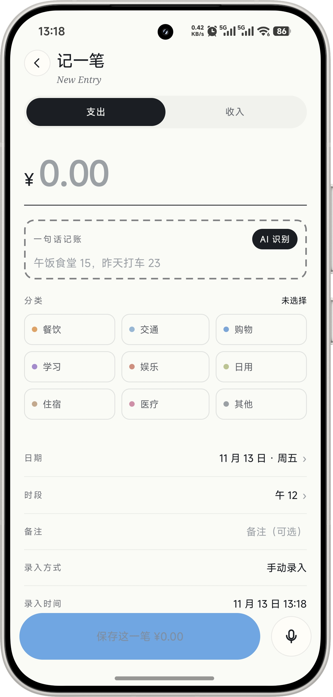
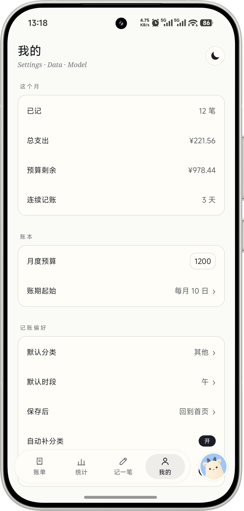
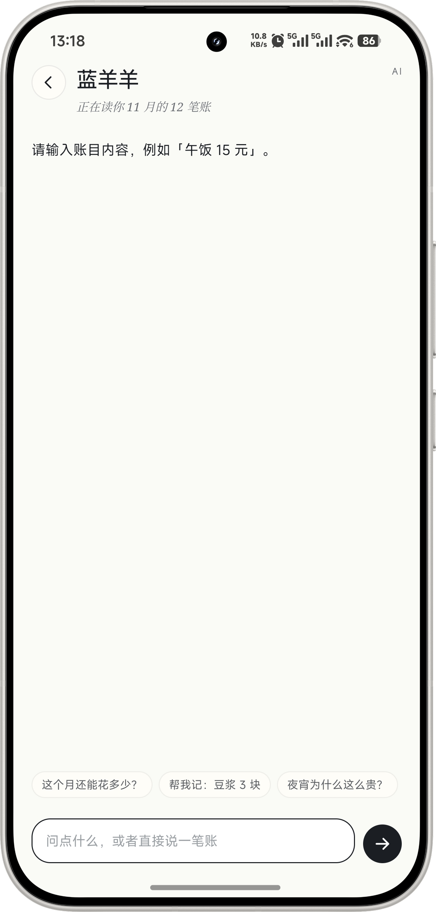
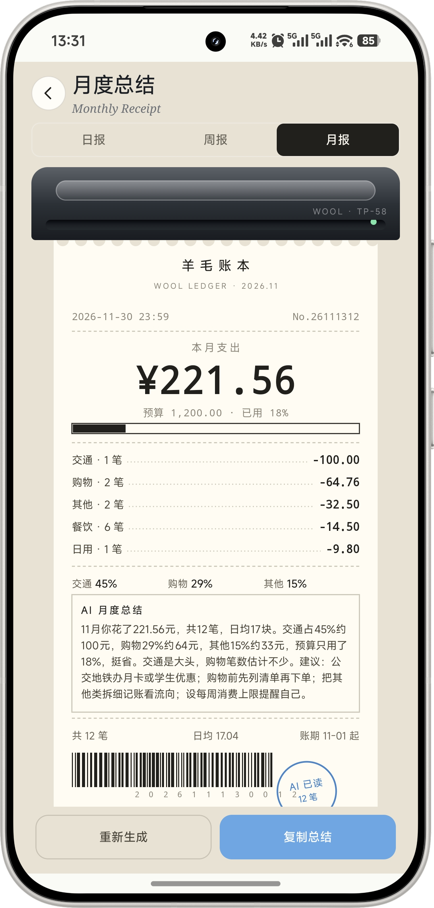

<div align="center">
  
  <h1>羊毛账本 · Wool Ledger</h1>
  <p><strong>一句话，记一笔。</strong></p>
  <p>把日常收支排成一张课表，让每一笔开销都有迹可循。</p>
  <p>
    
    
    <a href="LICENSE"></a>
  </p>
</div>

羊毛账本是一款原生 Android 个人记账应用。手动录入、用一句话描述消费，或通过离线语音输入，再用消费课表、分类统计和小票式报告回看消费习惯。账目保存在本机，无需注册账号，也无需部署后端。

**2.0 新增**：支付通知自动记账、待确认队列，以及可查账、记账、对账和撤销操作的蓝羊羊 Agent。

## 真机预览

以下六张图片来自 Android 真机，展示账单、统计、录入、设置、助手与月度总结界面。截图中的金额仅用于功能展示。

<table>
  <tr>
    <td align="center" width="33%"><br><strong>账单 · 一周收支一眼看清</strong></td>
    <td align="center" width="33%"><br><strong>统计 · 看见钱花在哪里</strong></td>
    <td align="center" width="33%"><br><strong>记一笔 · 手动、文字、语音</strong></td>
  </tr>
  <tr>
    <td align="center" width="33%"><br><strong>我的 · 按自己的节奏记账</strong></td>
    <td align="center" width="33%"><br><strong>蓝羊羊 · 和账本聊一聊</strong></td>
    <td align="center" width="33%"><br><strong>月度总结 · 打印一张消费小票</strong></td>
  </tr>
</table>

## 能做什么

- **一句话记账**：从「午饭食堂 15，昨天打车 23」提取金额、分类和日期，支持按标点拆分多笔记录。
- **消费课表**：以一周七天、早午晚夜四个时段展示账目；点击查看明细，长按拖拽调整日期与时段。
- **收支管理**：分类、搜索、编辑、删除与撤销，保留手动、AI、语音等录入来源。
- **预算与统计**：月度预算、自定义账期、每日支出、分类与时段分析、对比及明细下钻。
- **支付通知自动记账**：授权后本地解析所选支付软件的新通知。明确成功且信息完整的交易自动入账；缺失字段、退款转账和疑似重复进入待确认，可核对修正、忽略或撤销。
- **蓝羊羊 Agent**：通过受限账本工具完成多笔记账、按日期/分类/备注/编号查账、收支汇总、预算查询调整、按编号修改删除、疑似重复检查与金额核对。写账先展示预览，确认后执行，支持撤销和重启恢复。
- **小票报告**：保留日/周/月消费总结和小票式呈现，可接入用户自行选择的兼容接口。
- **日常工具**：CSV 导入导出、每日提醒、浅色与深色主题。

## 构建与运行

| 项目 | 要求 |
| --- | --- |
| 运行设备 | Android 7.0（API 24）及以上 |
| 原生架构 | `arm64-v8a`、`x86_64` |
| JDK | 17 或兼容版本 |
| Android SDK | Platform 35 |
| 构建工具 | Gradle 8.13 Wrapper、Android Gradle Plugin 8.13.2 |

```sh
git clone https://github.com/shanchuann/WoolLedger.git
cd WoolLedger/android/WoolLedger
./gradlew assembleDebug
```

Windows 使用 `gradlew.bat assembleDebug`。也可以用 Android Studio 打开 `android/WoolLedger`，安装所需 SDK、完成同步后点击 Run。命令行构建需设置 `ANDROID_HOME`，或在工程目录的 `local.properties` 中配置 `sdk.dir`。

产物位于 `android/WoolLedger/app/build/outputs/apk/debug/wool_ledger.apk`。连接设备后可运行 `./gradlew installDebug`。

首次启动会创建演示账目。如需从空账本开始，可在「我的 → 数据 → 清空所有账目」中清除；清空前请确认是否需要导出。

### 离线语音模型

工程包含 sherpa-onnx Android AAR；中文 Paraformer 模型单独下载，不进入 Git。构建任务会尝试从缓存或网络准备约 78 MB 的模型包，首次构建需要联网并可能耗时较长。下载地址与任务位于 `app/build.gradle`，其中包含 GitHub 及第三方镜像回退地址。

模型下载失败时仍可构建，应用内可继续安装模型。模型就绪后，语音识别在设备上运行。跳过模型准备可使用：

```sh
./gradlew assembleDebug -x prepareVoiceModelAsset
```

若本地 `app/src/main/assets/voice-model/` 已有模型，该命令仍会将它打入 APK。

### Release 签名

版本号由 `android/WoolLedger/version.properties` 管理。正式签名配置保存在本地 `keystore.properties`，格式见 [配置模板](android/WoolLedger/keystore.properties.example)。密钥库与密码不提交到仓库。未提供签名配置时，`assembleRelease` 生成未签名产物；本地安装请使用 debug 构建。

## 自动记账

在「我的 → 自动记账与 Agent → 支付通知自动记账」中开启，阅读说明后授予系统通知使用权，再选择微信、支付宝、云闪付或填写银行应用包名。发送通知的权限与读取通知的授权不同，不需要短信、无障碍或 Root 权限。

- 默认关闭通知读取，开启后默认将明确交易自动入账，也可切换成全部确认后入账。
- 仅处理开启后收到的新通知；没有通知、隐藏金额或通知格式不匹配时会漏记。首页和 Agent 页的「待确认」可查看、修正、忽略和撤销。
- 自动入账要求交易明确成功、金额唯一、商户与收支方向可识别，且没有重复迹象。相同交易号和相同事件幂等处理；同日同方向同金额或重复通知内容进入待确认，避免跨渠道重复记账。
- 退款、转账、还款只进入待确认，不自动当作收入或消费。它们目前没有独立的资产账户核算模型，应按实际用途处理或忽略。
- 微信额外限定支付相关通知标题；这属于通用规则，未承诺覆盖全部版本和所有银行。各厂商后台限制与支付软件通知模板需真机验证。关闭省电限制也不能保证完整流水。

## AI 与离线使用

蓝羊羊现在通过本地工具实际读写账本，统计数字由数据库计算。试试：

| 输入 | 行为 |
| --- | --- |
| `午饭15，地铁3` | 预览两笔账目，确认后写入 |
| `查本周餐饮支出` / `查2026年10月支出` | 返回筛选范围、合计和带编号明细 |
| `查备注含「食堂」的账单` / `查 #12` | 按备注或编号查账 |
| `把 #12 改为18元` / `把 #12 日期改到2026-11-12` | 预览修改后确认 |
| `删除 #12` / `预算设为1500` | 确认后执行，可撤销 |
| `当前账期还能花多少` | 按配置的账期起始日计算预算剩余 |
| `本月对账，合计221.56` | 比较提供的支出合计，列出疑似重复和待确认数量 |
| `撤销` | 找到最近一次可撤销 Agent 操作，点击卡片撤销 |

对账是检查本地账本与用户提供的合计，没有直接连接支付平台。疑似重复只提示，不自动删除。编辑过的账目不会被旧的撤销操作覆盖。

默认使用本地意图规则，适合上面的明确指令。复杂、多轮自然语言理解可在「我的 → 联网理解请求」另行开启，配置 API Base URL、API Key 和模型名；将向所选模型发送当前请求、近期对话和最多20笔账目摘要。模型只提出受限工具参数，写账仍需确认，不能执行任意 SQL 或代码。

接口需兼容 `POST {Base URL}/chat/completions`，Base URL 应包含服务所需的版本路径（例如 `/v1`）。默认配置为 DeepSeek 兼容接口，仓库不提供 API Key。未配置或请求失败时回退到本地工具；服务调用可能由提供商收费。月度报告与原有录入页的 AI 功能仍使用已有 API 配置。

## 数据与隐私

- 账目和预算保存在本机 SQLite，偏好与 API 配置保存在应用私有 SharedPreferences；当前 API Key 未做额外加密。
- 启用在线 AI 后，待解析文字、提问或账本摘要会发送至你配置的服务商。离线语音识别本身不上传录音；识别后的文字若交由在线 AI 解析，仍会发往该接口。
- 应用启用了 Android 系统备份，是否备份取决于设备及系统设置。CSV 导出文件也应由你妥善保管。
- 支付通知原文不上传 AI；本机保存最多1000字通知片段和解析结果用于核对，清空账目会清除通知内容与操作快照，保留必要的去重摘要。
- Agent 最近对话保存在本机（最多200条）；清空所有账目时同时清除。联网 Agent 默认关闭，需单独同意。
- 麦克风权限用于语音输入，发送通知权限用于记账提醒，通知使用权用于自动记账，网络权限用于模型下载和在线 AI 请求。

## 项目结构

```text
android/WoolLedger/
├── app/src/main/java/com/wool/ledger/
│   ├── ai/       # 在线接口、本地解析、离线语音
│   ├── data/     # SQLite、账目、分类与偏好
│   ├── automation/ # 通知监听、解析、去重与待确认
│   ├── agent/    # 意图规划、本地工具与确认/撤销执行
│   ├── ui/       # 账单、录入、统计、设置与助手
│   ├── view/     # 消费课表、堆叠柱、小票等自绘组件
│   ├── notify/   # 记账提醒
│   └── util/     # 日期、金额、模型安装与主题工具
├── app/src/main/res/
└── version.properties
docs/screenshots/  # README 真机截图
```

界面使用 Java、Android Views 与自定义 Canvas 绘制；数据层使用 SQLite，无独立服务端。

## 参与贡献

欢迎通过 [Issues](https://github.com/shanchuann/WoolLedger/issues) 提交问题或建议。请附上应用版本、Android 版本、设备型号和复现步骤，截图与日志请先移除个人账目及 API Key。

提交 Pull Request 前请运行 `assembleDebug` 和 `lintDebug`，验证涉及页面的浅色、深色显示与主要操作。涉及解析规则时，请附输入示例、预期字段和实际结果。

### 当前验证状态

2.0 构建与测试记录见 [升级与验收说明](docs/upgrade-v2.md)。Debug、Release 构建与 Lint 已通过；Lint 仍有既有警告，并临时停用旧版 Fragment 中三个递归耗时的生命周期检查（代码未使用对应 API）。数据库迁移、通知解析、去重、确认撤销与 Agent 工具通过自动化回归；真实支付软件通知覆盖率和联网模型质量需要单独验收。以上六张真机截图来自 1.54，保留作原有界面演示，尚不展示 2.0 新入口。

## 许可与致谢

项目原创代码使用 [MIT License](LICENSE)。第三方库、模型及其附带组件遵循各自许可证，见 [第三方声明](THIRD_PARTY_NOTICES.md)。感谢 sherpa-onnx、AndroidX、Material Components 等项目提供支持。
